# Energy Sector Deep Dive

[](https://github.com/ParBproject/energy-sector-deep-dive/actions/workflows/ci.yml)

[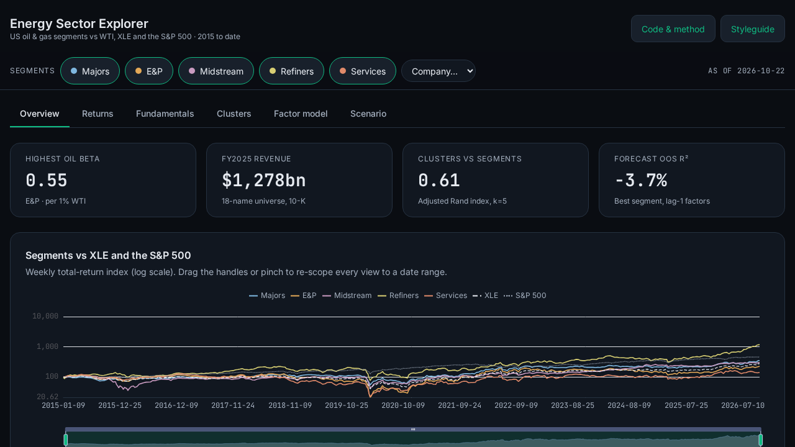](https://parbproject.github.io/energy-sector-deep-dive/)

**[Open the live explorer →](https://parbproject.github.io/energy-sector-deep-dive/)** · **[Read the findings →](docs/findings.md)**

How do the five segments of US oil & gas (integrated majors, producers, pipelines, refiners
and oilfield services) actually trade against oil, gas, XLE and the S&P 500, from the 2015–16
bust through 2020 and 2022 to today? This repo is a reproducible, point-in-time research
pipeline whose results are presented in an interactive explorer.

It is the companion to [commodity-price-forecaster](https://github.com/ParBproject/commodity-price-forecaster).
Both use the same WTI, Brent and Henry Hub series (Yahoo `CL=F`, `BZ=F`, `NG=F`).

> Status: **Milestone 6 (polish and launch)** complete. Live: https://parbproject.github.io/energy-sector-deep-dive/
> Employer-facing write-up with limitations: [`docs/findings.md`](docs/findings.md). Findings below are generated from `results/*.json`.

## Scope
- **Period:** 2015-01-02 to present, daily prices; quarterly and annual fundamentals.
- **Universe** (fixed as of 2015, see [`config/universe.yaml`](config/universe.yaml)):

| Segment | Tickers |
|---|---|
| Integrated majors | XOM, CVX, COP |
| Exploration & production | EOG, DVN, FANG, OXY, APA |
| Midstream | KMI, WMB, OKE, ET |
| Refining | MPC, VLO, PSX |
| Oilfield services | SLB, HAL, BKR |
| Benchmarks | XLE, SPY / ^GSPC |

- **Survivorship bias, stated plainly:** these are the names that survived. Anadarko, Noble,
  Concho, Pioneer, Marathon Oil, Hess, Cimarex, Chesapeake (old equity), Whiting, Spectra,
  Tesoro/Andeavor, Cameron, FMC Technologies and Weatherford were in the 2015 opportunity set
  and are listed with their fate in the config. Segment returns will be read with that in mind.

## Data sources
| Source | What | Access |
|---|---|---|
| [yfinance](https://github.com/ranaroussi/yfinance) | Adjusted daily closes, benchmarks, front-month futures | keyless |
| [FRED](https://fred.stlouisfed.org/) | WTI/Brent/Henry Hub spot, 10y and 3m rates, CPI, industrial production | `FRED_API_KEY` optional; falls back to keyless `fredgraph.csv` |
| [SEC EDGAR XBRL](https://www.sec.gov/edgar/sec-api-documentation) | Company facts with **filing dates** for point-in-time fundamentals | keyless; descriptive `SEC_USER_AGENT` required |
| [EIA API v2](https://www.eia.gov/opendata/) | US crude production, stocks, rotary rigs (refreshed weekly, see [Live EIA data](#live-eia-data)) | `EIA_API_KEY` required |
| [Baker Hughes rig count](https://rigcount.bakerhughes.com/) | Weekly North America rigs | manual file (site blocks scripts) or EIA mirror |
| [Fama-French](https://mba.tuck.dartmouth.edu/pages/faculty/ken.french/data_library.html) | Daily 3 factors | keyless |

Column-level detail: [`docs/data_dictionary.md`](docs/data_dictionary.md). Every pull is cached
to `data/raw/` with its fetch date; a small real snapshot (≈0.5 MB) is committed in
`data/snapshot/` so tests and later milestones run offline.

## Explorer demo

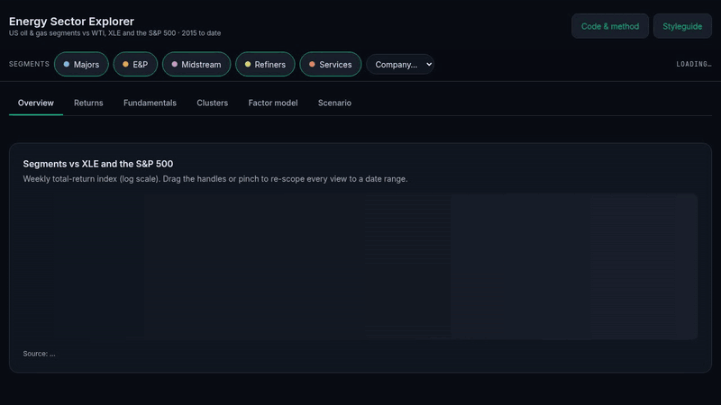

Six linked views (overview, returns and drawdowns, fundamentals, clusters, factor model, oil scenario) share one URL-synced state, so any view can be linked to directly. The explorer is usable by keyboard (skip link, visible focus rings, a company picker as a keyboard path to the drill-down, Escape closes the detail panel and returns focus). Every chart carries an ARIA label and an ECharts-generated text description, and the app honours reduced motion. axe reports 0 violations across all views at 1280 px and 390 px. Lighthouse (mobile, live site, 2026-10-22): performance 94–96, accessibility 100, best practices 100, SEO 100.

<!-- findings:start -->
## Findings (M2)

_Generated by `python -m scripts.run_m2` from `results/*.json`. Data as of 2026-10-22._

### Oil beta
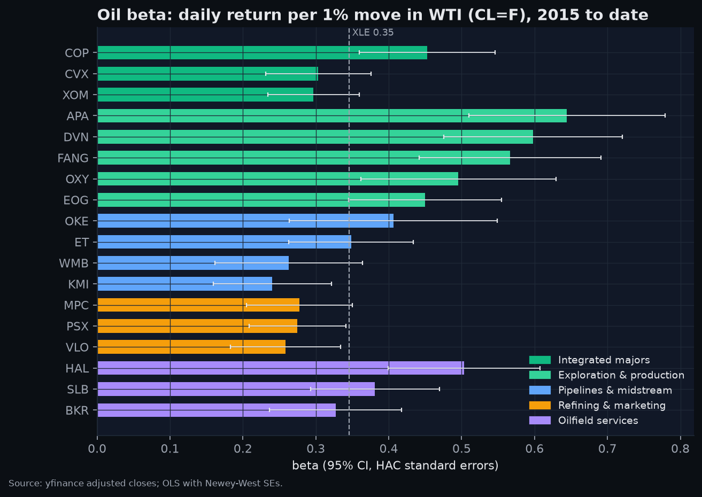

- **Exploration & production** is the most oil-sensitive segment: beta 0.55 per 1% WTI move (HAC t = 9.1). **Refining & marketing** is the least: 0.27. XLE: 0.35; S&P 500: 0.07.

| Segment | Oil beta | 95% CI | R² | 60d corr WTI (latest) | 60d corr S&P (latest) |
|---|---|---|---|---|---|
| Integrated majors | 0.35 | 0.28 to 0.43 | 0.31 | 0.64 | -0.43 |
| Exploration & production | 0.55 | 0.43 to 0.67 | 0.35 | 0.68 | -0.29 |
| Pipelines & midstream | 0.31 | 0.22 to 0.41 | 0.20 | 0.11 | -0.09 |
| Refining & marketing | 0.27 | 0.20 to 0.34 | 0.12 | 0.33 | -0.17 |
| Oilfield services | 0.40 | 0.31 to 0.50 | 0.25 | 0.11 | 0.15 |

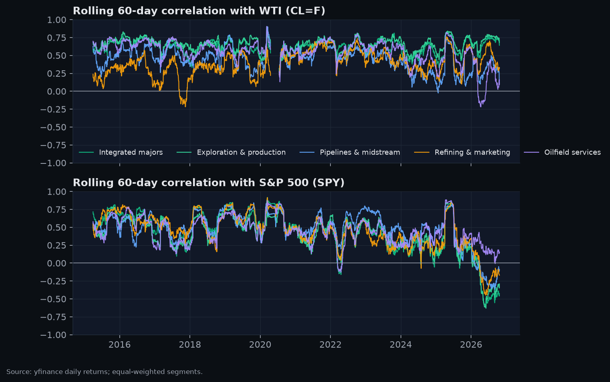

### Drawdowns in the three shocks
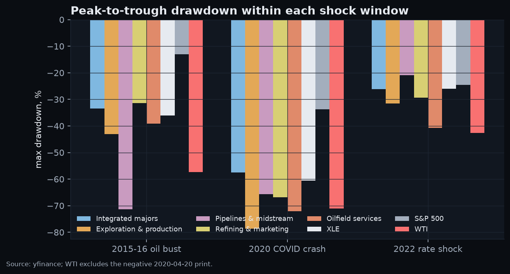

| Shock | Integrated majors | Exploration & production | Pipelines & midstream | Refining & marketing | Oilfield services | XLE | S&P 500 | WTI |
|---|---|---|---|---|---|---|---|---|
| 2015-16 oil bust | -33.4% | -43.0% | -71.3% | -31.4% | -39.2% | -36.1% | -13.0% | -57.3% |
| 2020 COVID crash | -57.5% | -78.7% | -65.6% | -66.8% | -72.1% | -60.6% | -33.7% | -71.1% |
| 2022 rate shock | -26.1% | -31.6% | -20.9% | -29.3% | -40.7% | -26.0% | -24.5% | -42.6% |

### Market sizing (proxy)
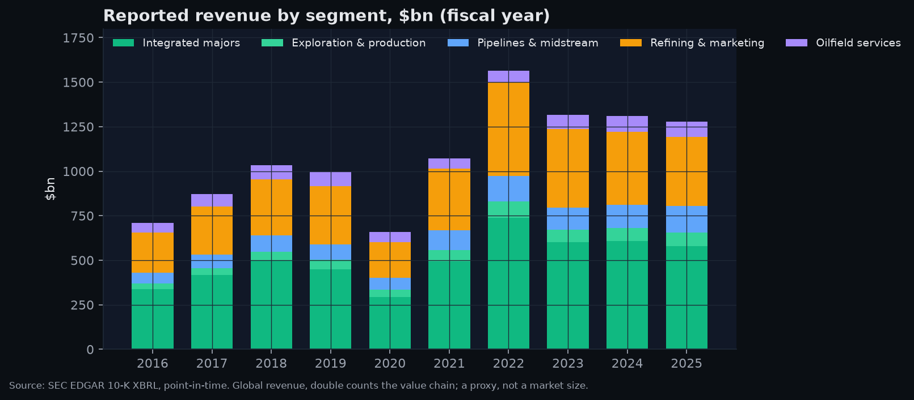

- Top-down: US field crude output in 2025 was 13,662 kb/d (4.99bn bbl), worth **$326bn** at monthly average WTI (EIA MCRFPUS2 x FRED DCOILWTICO; EIA data as of 2026-10-23). Wellhead value at WTI Cushing spot; realized prices differ by grade and basin. Crude only: excludes natural gas, NGLs and refined products. Production for recent months is EIA's estimate and is revised in later releases.
- Bottom-up proxy: the universe reported **$1,278bn** of FY2025 revenue (17 of 18 companies; missing: APA). Average WTI in 2025: $65.39/bbl.
- Shares of that revenue: Integrated majors 45.4%, Exploration & production 6.0%, Pipelines & midstream 11.6%, Refining & marketing 30.3%, Oilfield services 6.7%.
- Caveats: Revenue is global and consolidated, not US-only. Segments double count: refiners' revenue includes crude bought from producers. Majors' and refiners' revenue include pass-through product sales, so revenue overstates value added; it measures scale of flows, not market value. Survivor universe of 18 names: excludes private producers and acquired/bankrupt names. Companies without a standard us-gaap revenue tag are left out, not estimated.

### Fundamentals (point-in-time, filing dates)
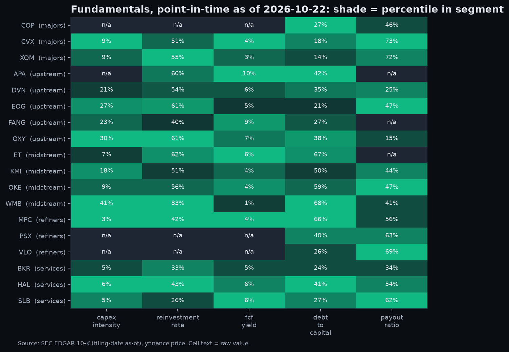

| Segment median | Capex / revenue | Capex / operating cash flow | (Operating cash flow - capex) / market cap | Total debt / (total debt + equity) | (Dividends + buybacks) / operating cash flow |
|---|---|---|---|---|---|
| Integrated majors | 8.9% | 52.8% | 3.5% | 17.6% | 72.2% |
| Exploration & production | 25.2% | 60.3% | 6.5% | 35.1% | 24.9% |
| Pipelines & midstream | 13.6% | 59.2% | 4.0% | 62.6% | 44.0% |
| Refining & marketing | 2.6% | 42.2% | 3.6% | 40.4% | 63.1% |
| Oilfield services | 4.7% | 33.4% | 5.9% | 27.2% | 54.2% |

Not computed where a company files the input under a non-standard tag (left blank rather than estimated): capex_intensity: APA, COP, PSX, VLO; reinvestment_rate: COP, PSX, VLO; fcf_yield: COP, PSX, VLO; payout_ratio: APA, ET, FANG.
<!-- findings:end -->

<!-- m3-findings:start -->
## Findings (M3)

_Generated by `python -m scripts.run_m3` from `results/*.json`._

### Do fundamentals rediscover the segments?
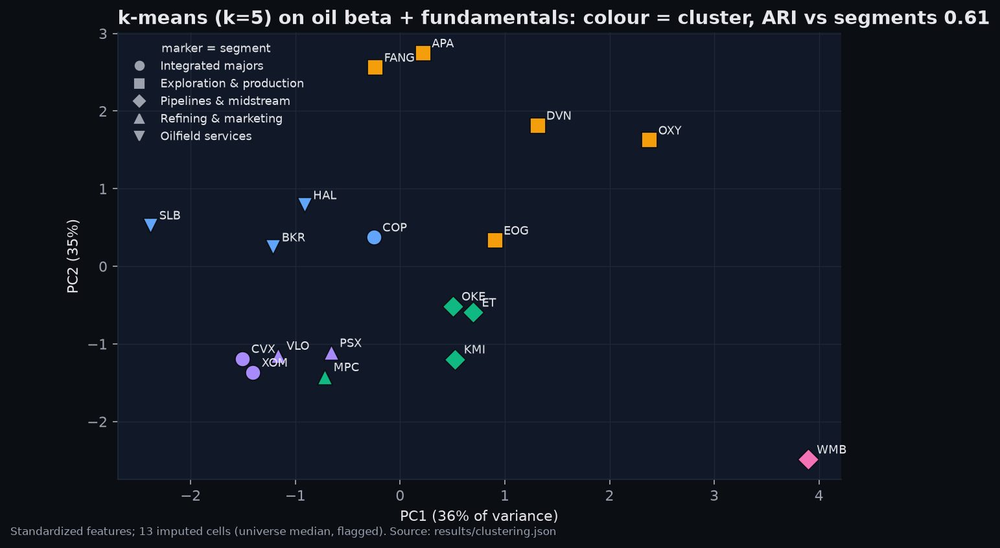

- k-means (k=5): silhouette 0.27, adjusted Rand vs the 5 segments **0.61**. Ward hierarchical: silhouette 0.27, ARI 0.61.
- The segments themselves score a silhouette of only 0.10 on these features. Best k by silhouette: 6 (k-means).
- 13 of 108 feature cells were imputed (universe median per feature, flagged; then z-scored). Complete-case check (12 companies, dropping APA, COP, ET, FANG, PSX, VLO): ARI 0.76.

### Factor model (weekly, HAC)
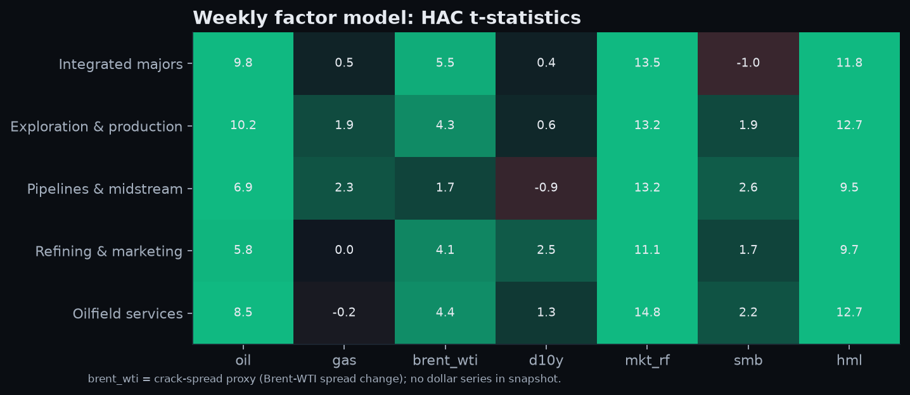

- Sample 2015-01-09 to 2026-08-28 (608 weeks). Crack-spread proxy: weekly change in (Brent - WTI) / WTI from BZ=F and CL=F futures; RBOB/heating-oil futures not in snapshot. Dollar: unavailable: no dollar index series in snapshot.

| Segment | In-sample R² | OOS R², same-week factors | OOS R², last week's factors |
|---|---|---|---|
| Integrated majors | 0.69 | 67.6% | -6.0% |
| Exploration & production | 0.69 | 66.8% | -5.6% |
| Pipelines & midstream | 0.54 | 53.3% | -7.7% |
| Refining & marketing | 0.57 | 57.1% | -3.7% |
| Oilfield services | 0.65 | 64.2% | -5.8% |

OOS R² is against an expanding historical-mean baseline, refit weekly after 156 training weeks. Same-week factors show the exposures are stable; last week's factors show they do not forecast next week.

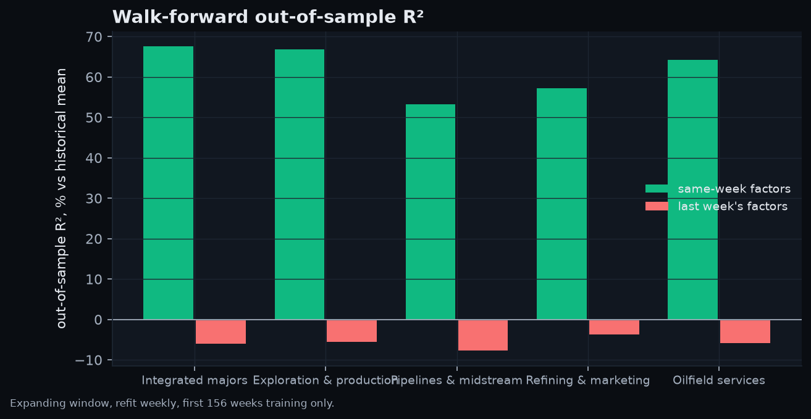

### Oil scenarios (sensitivity, not a signal)
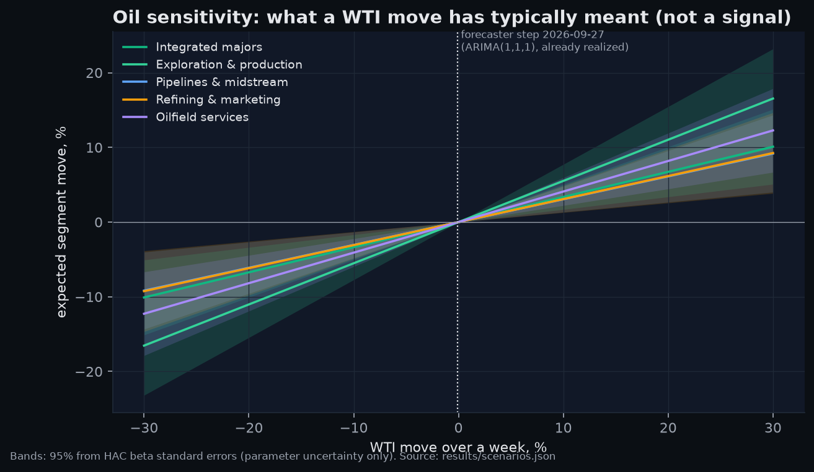

| Segment | Weekly oil beta | Expected move if WTI -10% | 95% band (beta SE) |
|---|---|---|---|
| Integrated majors | 0.34 | -3.4% | -5.0% to -1.7% |
| Exploration & production | 0.55 | -5.5% | -7.7% to -3.3% |
| Pipelines & midstream | 0.31 | -3.1% | -4.8% to -1.3% |
| Refining & marketing | 0.31 | -3.1% | -4.9% to -1.3% |
| Oilfield services | 0.41 | -4.1% | -6.0% to -2.2% |

Forecaster tie-in: the latest one-step WTI forecast published by [commodity-price-forecaster](https://github.com/ParBproject/commodity-price-forecaster) (ARIMA(1,1,1), week 2026-09-27, commit `78b63d2`) implied -0.07%; WTI actually moved -7.87%. That step is already realized, so the explorer defaults to a slider and offers the forecast only as a preset.
<!-- m3-findings:end -->

## Roadmap
1. **M1 – Scope and data** ✅ universe, cached loaders, point-in-time EDGAR, offline snapshot, CI workflow (staged).
2. **M2 – Core analyses** ✅ market sizing (bottom-up proxy), oil beta with HAC errors, rolling correlations, shock drawdowns, point-in-time fundamentals. Notebooks in `notebooks/`.
3. **M3 – Modelling** ✅ clustering vs segments (silhouette, ARI), weekly HAC factor model with walk-forward OOS R², leakage tests, oil scenario module fed by the commodity forecaster (`src/scenarios/`).
4. **M4 – Design system and app shell** ✅ `web/`: Vite + React + TS, tokens in one file shared with the Python charts, ECharts theme, sticky filters, KPI strip, chart cards, 390 px mobile layout, styleguide route.

   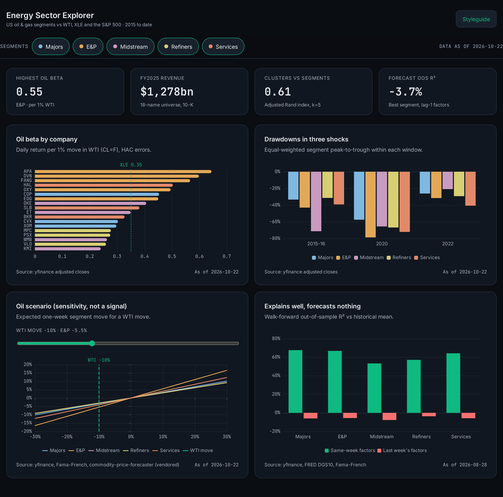
5. **M5 – Interactive explorer** ✅ six views from exported data, Zustand store synced to the URL hash, linked filters, brush-to-zoom, synced hover, sector → segment → company drill-down, compare pins, oil-scenario slider with the commodity forecaster as a dated preset (a what-if tool, not a signal). Deployed to GitHub Pages from `gh-pages` (no workflow).
6. **M6 – Polish and launch** ✅ accessibility pass (axe: 0 violations), ECharts and Framer Motion code-split, Lighthouse mobile ≥ 90, demo GIF and hero image, [findings write-up](docs/findings.md), cross-links with commodity-price-forecaster.

## How to run
```bash
python -m venv .venv && source .venv/bin/activate
pip install -r requirements-dev.txt

pytest -q            # offline: uses data/snapshot/ and mocked HTTP
ruff check . && ruff format --check .

# optional keys
export FRED_API_KEY=...        # otherwise keyless fredgraph.csv
export EIA_API_KEY=...         # needed only to refresh data/snapshot/eia.* (python -m scripts.refresh_eia)
export SEC_USER_AGENT="Your Name you@example.org"

python -m scripts.build_snapshot   # refetch everything into data/raw/ and rebuild data/snapshot/
python -m scripts.run_m2           # offline: results/*.json, docs/img/*.png, README findings
python -m scripts.run_m3           # offline: clustering, factor model, scenarios
python -m scripts.make_notebooks   # rebuild and execute notebooks/0*.ipynb
```

**SEC User-Agent.** SEC EDGAR asks automated clients for a `"Name email"` User-Agent. The code reads it from the
`SEC_USER_AGENT` environment variable; if that is unset it falls back to the project contact
`Par Bahrae githubproproject@proton.me`. In GitHub Actions the value comes from the `SEC_USER_AGENT` repository secret.
Set your own when you re-fetch: `export SEC_USER_AGENT="Your Name you@example.com"`.

## Repo layout
```
config/universe.yaml   fixed 2015 universe, segments, M&A / bankruptcy notes
src/data/              cached loaders: prices, fred, edgar, eia, rigs, famafrench, snapshot
src/analysis/          returns, betas, fundamentals, clustering, regression
src/scenarios/         oil-price what-if mapping
src/export/            JSON for the web app
scripts/               build_snapshot.py, refresh_eia.py (weekly EIA pull)
data/snapshot/         committed real data + manifest.json
notebooks/ results/ docs/img/ web/
tests/                 loaders, cache, point-in-time filing dates, snapshot
```

## Live EIA data
The EIA series are pulled, validated, committed and deployed by
[`.github/workflows/eia-refresh.yml`](.github/workflows/eia-refresh.yml).

| Series | EIA id (API v2 route) | Frequency | Used for |
|---|---|---|---|
| US field crude production, kb/d | `MCRFPUS2` (`petroleum/crd/crpdn`) | monthly | top-down market size (x FRED WTI), Overview chart |
| US commercial crude stocks ex-SPR, kbbl | `WCESTUS1` (`petroleum/stoc/wstk`) | weekly | Overview chart |
| US crude + gas rotary rigs | `E_ERTRRO_XR0_NUS_C` (`petroleum/crd/drill`) | monthly, published with a lag of several months | Overview chart |

**Schedule.** Thursdays 15:30 UTC (after EIA's Wednesday Weekly Petroleum Status Report), plus
manual runs.

**Pipeline.** One job, `permissions: contents: write`, using the `EIA_API_KEY` repository secret:
1. `python -m scripts.refresh_eia` fetches all three series from 2015 and validates each one:
   expected columns and series id, non-empty, numeric, wide physical sanity ranges, unique and
   ascending periods, history starting in 2015, latest period not in the future and not stale,
   and never moving backwards or losing rows compared with the committed snapshot.
2. Only if **every** series passes, `data/snapshot/eia.csv.gz` and `data/snapshot/eia_meta.json`
   are swapped in atomically. `eia_meta.json` carries the as-of date (UTC retrieval date), the
   retrieval timestamp and each series' latest period.
3. `run_m2`, `run_m3` and `src.export.web` regenerate `results/`, the README findings and
   `web/public/data/` from the new snapshot, then ruff, pytest and the web tests and build run as a
   gate. The exact-match result tests therefore check the snapshot that run is about to commit.
4. The bot commits straight to `main` as `data: EIA refresh, data as of YYYY-MM-DD`. `main` has no
   branch protection and the change is data only and already tested in step 3, so an auto-merged PR
   would add nothing. If `main` becomes protected, switch this step to a PR.
5. The explorer is rebuilt and pushed to `gh-pages`; GitHub Pages then publishes it. Every EIA chart
   shows `Data as of <date> · Source: U.S. EIA`, read from `eia_meta.json` via `eia.json`.

**Failure behaviour.** If EIA returns an error, a malformed or truncated response, or any series
fails validation, nothing is written: the last good snapshot stays, the run fails (red) and the
exact error is in the run summary. No value is ever filled, interpolated or carried forward. The
key is never printed: request errors are reported without the URL.

**Run it manually.** Actions → *EIA refresh* → *Run workflow*, or
`gh workflow run eia-refresh.yml`. Locally: `EIA_API_KEY=... python -m scripts.refresh_eia`
(add `--check` to fetch and validate without writing). PRs that touch the pipeline run a live
fetch into a scratch directory and upload it as the `eia-preview` artifact, without committing.

## Deploying the explorer
The *EIA refresh* workflow rebuilds and deploys it on every run. To deploy by hand, build with
`cd web && npm run build` (Vite `base` is `/energy-sector-deep-dive/`), then push the contents of
`web/dist` plus `.nojekyll` to the `gh-pages` branch. Pages serves `gh-pages /`.

## License
MIT

> CI: the workflow is staged at [`docs/ci.yml.proposed`](docs/ci.yml.proposed). Move it to
> `.github/workflows/ci.yml` (needs a token with `workflow` scope, or the GitHub web UI) to enable ruff + pytest on every PR.

## Explorer screenshots

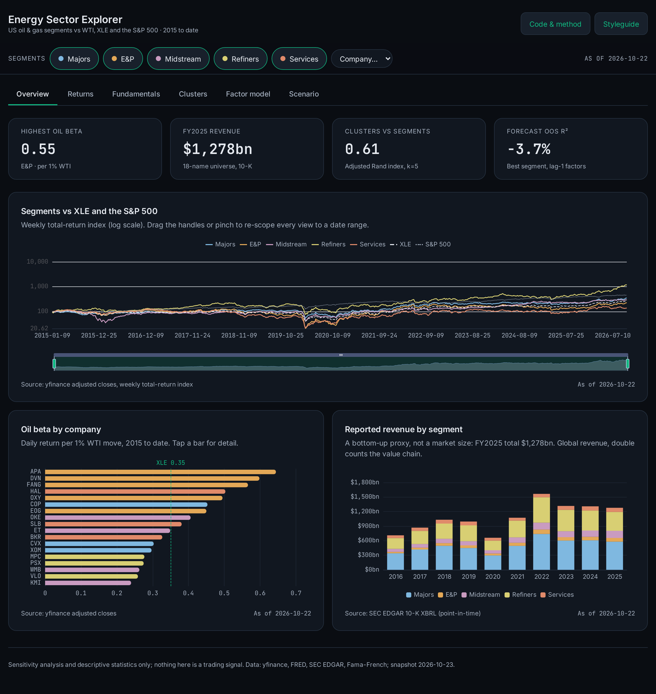
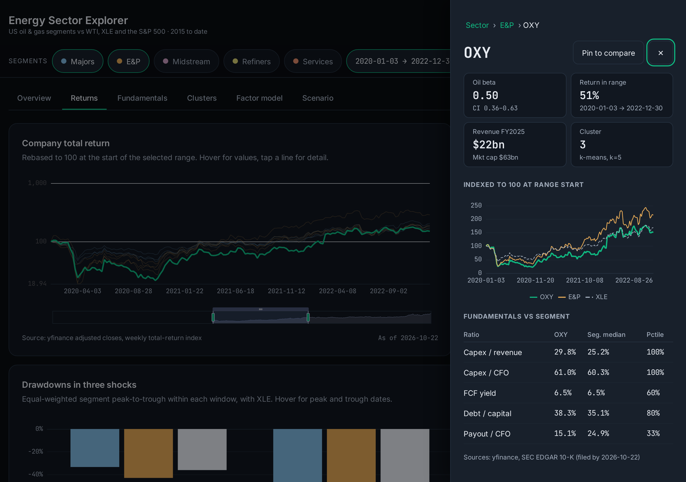
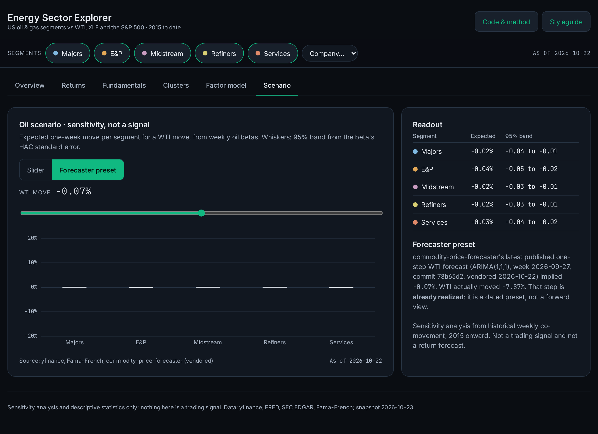
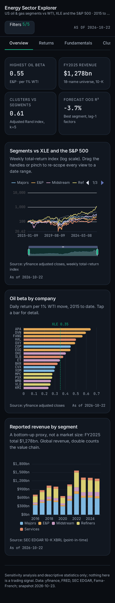
